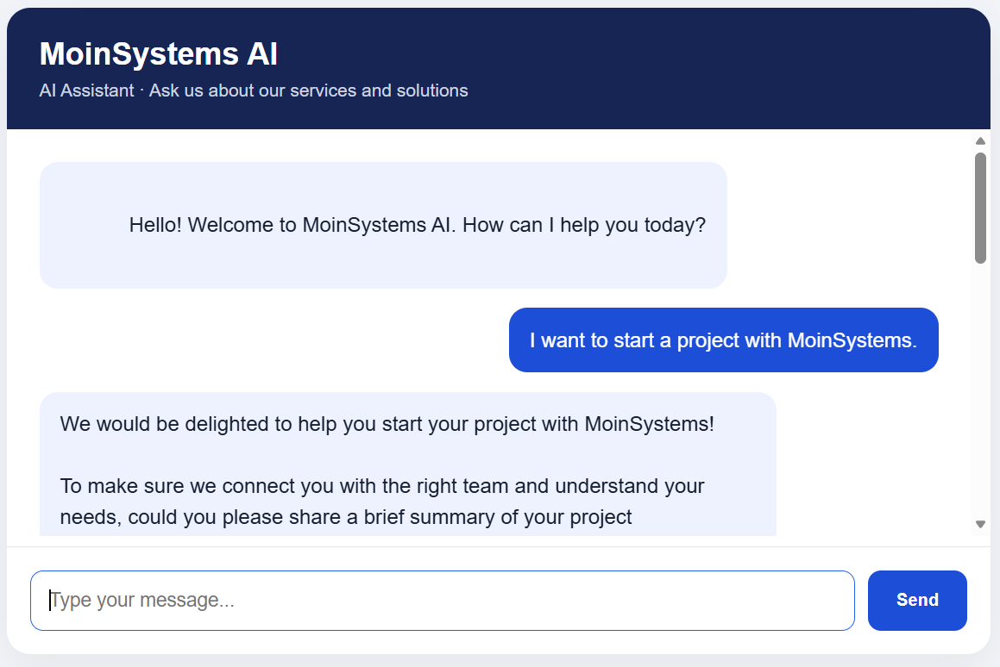
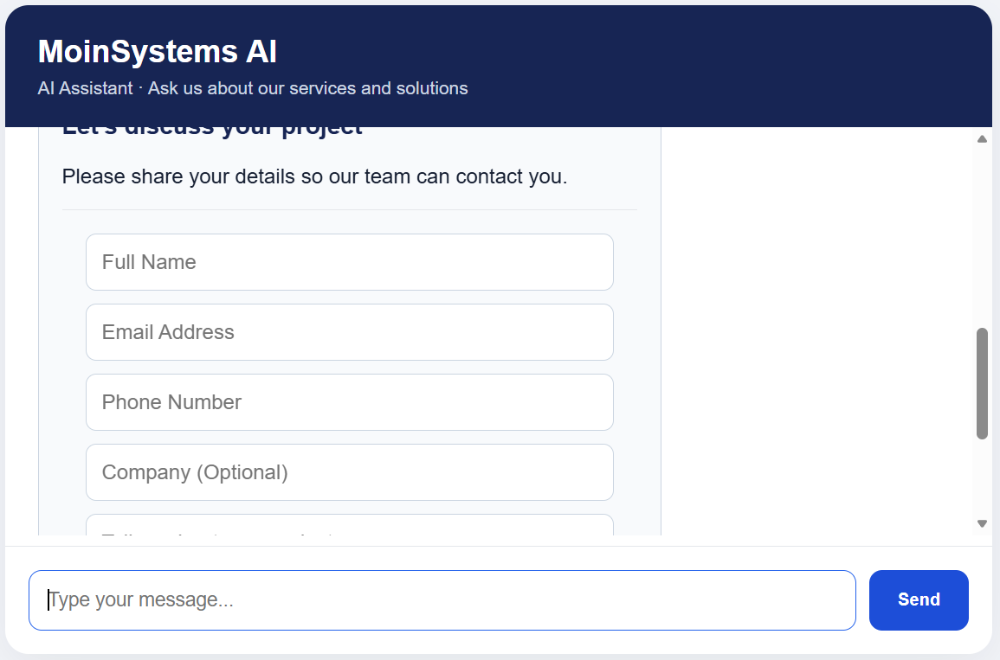
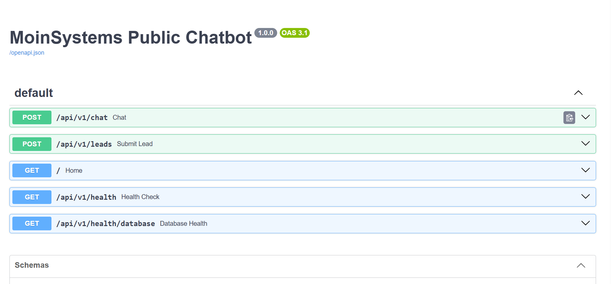
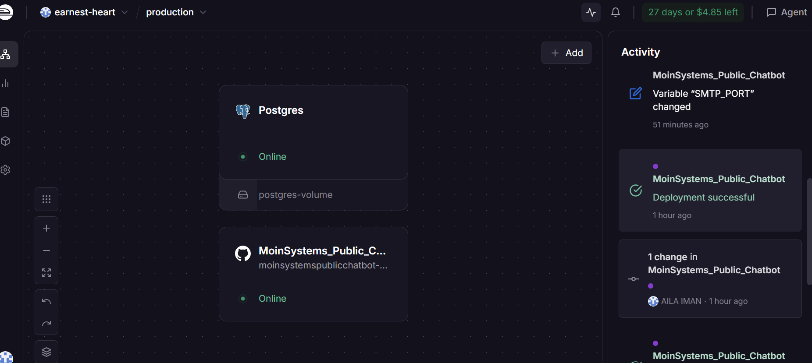
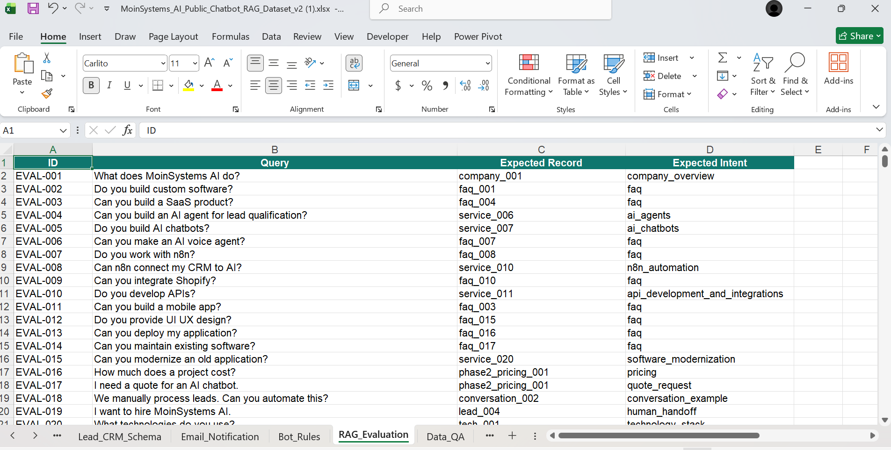

# MoinSystems AI — Public Website Chatbot

An AI-powered website chatbot built for MoinSystems. It answers company-related questions using an approved knowledge base and a Retrieval-Augmented Generation (RAG) workflow. It also collects prospective customer enquiries.

> **Deployment status:** The FastAPI application is deployed on Railway. The live chatbot, cloud database, knowledge retrieval, and lead capture have been tested.

## Demo

The screenshots are arranged in a compact two-column layout to keep the README easy to scan. Each image is displayed at a controlled width rather than taking up the full page.

<table>
  <tr>
    <td align="center" width="50%">
      <strong>1. Chatbot conversation</strong><br/>
      
    </td>
    <td align="center" width="50%">
      <strong>2. Lead capture form</strong><br/>
      
    </td>
  </tr>
  <tr>
    <td align="center" width="50%">
      <strong>3. API documentation</strong><br/>
      
    </td>
    <td align="center" width="50%">
      <strong>4. Dataset verification</strong><br/>
      
    </td>
  </tr>
  <tr>
    <td align="center" width="50%">
      <strong>5. Railway deployment</strong><br/>
      
    </td>
    <td width="50%"></td>
  </tr>
</table>

## Features

- AI-powered responses using Google Gemini.
- RAG-based question answering grounded in an approved company knowledge base.
- Semantic retrieval using Gemini text embeddings.
- Conversation sessions and message history.
- Lead capture with PostgreSQL persistence.
- Responsive web-based chatbot interface.
- REST API with interactive Swagger documentation.
- Health-check endpoints for the application and database.

## Technology Stack

| Area | Technologies |
|---|---|
| Backend | Python, FastAPI |
| Generative AI | Google Gemini |
| Embeddings | `gemini-embedding-001` |
| Retrieval | Embedding-based semantic similarity |
| Database | PostgreSQL |
| ORM and migrations | SQLAlchemy, Alembic |
| Frontend | HTML, CSS, JavaScript |
| Email | Python SMTP (local testing) |
| Deployment | Railway |

## How It Works

1. A visitor submits a question through the chatbot interface.
2. The backend generates an embedding for the query.
3. The retrieval service compares the query embedding with stored knowledge embeddings.
4. Relevant knowledge records are selected and supplied as context to Gemini.
5. Gemini generates a response using the retrieved context.
6. The chatbot displays the answer and available source information.
7. A visitor can submit contact details through the lead form; lead data is stored in PostgreSQL.

## Knowledge Base and Evaluation

The source spreadsheet contained 99 entries. After review and cleaning:

- **97 validated records** were included in the knowledge base.
- **2 records** were excluded because their source information contained gaps.
- **97 embeddings** were generated and verified in the Railway database.
- Each stored embedding contains **768 dimensions**.
- **32 evaluation questions** were prepared for retrieval testing.

### Retrieval evaluation results

| Metric | Result |
|---|---:|
| Hit@3 | 87.50% |
| Hit@5 | 96.88% |
| MRR | 0.6937 |

These figures describe retrieval performance on the prepared evaluation set. They are not a measure of overall generated-answer accuracy.

## Project Structure

```text
MoinSystems_Public_Chatbot/
├── app/
│   ├── api/             # Chat and lead API routes
│   ├── db/              # Database connection and sessions
│   ├── models/          # SQLAlchemy models
│   └── services/        # Chat, embeddings, retrieval, email
├── data/                # Knowledge base and evaluation data
├── frontend/            # Chatbot user interface
├── migrations/          # Alembic migration files
├── scripts/             # Ingestion, embedding and evaluation scripts
├── screenshots/         # Project screenshots used in this README
├── .env.example         # Environment-variable template
├── requirements.txt
└── README.md
```

## Run Locally

### Prerequisites

- Python 3.10+
- PostgreSQL
- A Google Gemini API key

### Installation

1. Clone the repository:

   ```bash
   git clone https://github.com/ailaiman2136-lang/MoinSystems_Public_Chatbot.git
   cd MoinSystems_Public_Chatbot
   ```

2. Create and activate a virtual environment:

   ```bash
   python -m venv .venv
   ```

   Windows PowerShell:

   ```powershell
   .\.venv\Scripts\Activate.ps1
   ```

3. Install dependencies:

   ```bash
   pip install -r requirements.txt
   ```

4. Create a local `.env` file based on `.env.example` and configure the required values. Do not commit the real `.env` file.

5. Apply database migrations:

   ```bash
   python -m alembic upgrade head
   ```

6. Ingest the approved knowledge records:

   ```bash
   python scripts/ingest_knowledge.py
   ```

7. Generate or refresh knowledge embeddings:

   ```bash
   python scripts/generate_embeddings.py
   ```

8. Start the API:

   ```bash
   python -m uvicorn app.main:app --reload
   ```

Open the chatbot at `http://127.0.0.1:8000/` and the API documentation at `http://127.0.0.1:8000/docs`.

## API Endpoints

| Method | Endpoint | Purpose |
|---|---|---|
| POST | `/api/v1/chat` | Submit a chat message |
| POST | `/api/v1/leads` | Submit a prospective customer lead |
| GET | `/api/v1/health` | Application health check |
| GET | `/api/v1/health/database` | Database connectivity check |
| GET | `/docs` | Interactive Swagger API documentation |

## Deployment and Verification

The application and PostgreSQL database are deployed on Railway.

Verified deployment checks:

- Application starts successfully on Railway.
- Application health endpoint responds successfully.
- Database health endpoint responds successfully.
- 97 knowledge records are present in the cloud database.
- 97 embeddings are present, each with 768 dimensions.
- Live chatbot queries return responses successfully.
- Lead submissions return HTTP 200 and are stored in PostgreSQL.

## Known Limitation

Lead capture and database storage are working. Email notification delivery was tested successfully in the local environment. On Railway, outbound SMTP connections return `[Errno 101] Network is unreachable`, so hosted email delivery is currently unavailable. A successful lead API response confirms lead submission; it does **not** confirm that an email was delivered.

## Security

- Keep API keys, database URLs, SMTP credentials, and other secrets in environment variables.
- Never commit `.env`, credentials, or real customer lead data.
- Use only approved company information in the knowledge base.

## Learning Outcomes

This project provided practical experience with:

- Building APIs using FastAPI.
- Preparing and validating a knowledge base.
- Generating and using text embeddings.
- Implementing semantic retrieval and a RAG workflow.
- Integrating a generative AI model.
- Managing PostgreSQL with SQLAlchemy and Alembic.
- Testing API, retrieval, and database behaviour.
- Deploying and troubleshooting a cloud-hosted application.

---

**Project:** MoinSystems AI Public Website Chatbot  
**Repository:** [MoinSystems_Public_Chatbot](https://github.com/ailaiman2136-lang/MoinSystems_Public_Chatbot)
